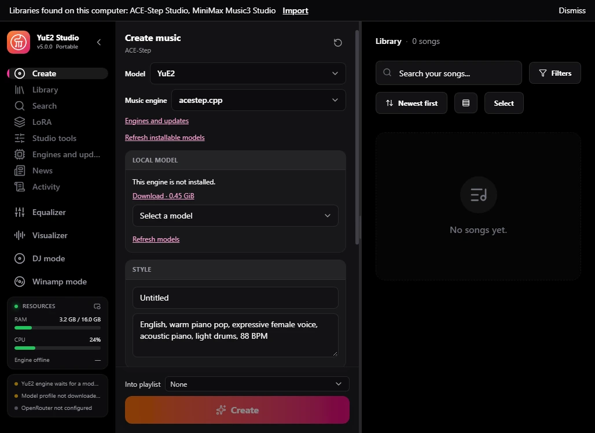

# YuE2 Studio

[English](README.md) · [Русский](README.ru.md) · [中文](README.zh.md) · [日本語](README.ja.md) · **한국어** · [Português](README.pt.md)

YuE2, ACE-Step, MiniMax로 한 스튜디오에서 음악을 만드세요. 곡과 플레이리스트를 가져오고, 테이크를 비교하고, RVC로 다른 목소리를 들어 볼 수 있습니다.

[YuE2 Studio 다운로드](https://github.com/timoncool/YuE2-Studio/releases/latest) · [프로젝트 사이트](https://timoncool.github.io/YuE2-Studio/ko.html) · [프로젝트 후원](DONATE.ko.md)

## 첫 곡 만들기

Windows x64용 설치 프로그램과 포터블 ZIP, Linux x86-64용 DEB와 AppImage, Apple Silicon Mac용 DMG를 제공합니다. 처음 실행할 때 선택한 모델에 필요한 구성 요소와 가중치를 설치하세요.

**생성** 화면에서 YuE2와 설치된 모델 프로필을 선택하세요. 스타일과 가사를 입력하거나 예제를 불러오세요. **생성**을 누른 뒤 **라이브러리**에서 완성된 곡을 재생할 수 있습니다.

## 라이브러리 이전

**라이브러리 → 가져오기 → ACE-Step 또는 MiniMax 라이브러리**를 여세요. 찾은 ACE-Step Studio 또는 MiniMax Music3 Studio 라이브러리를 선택하거나 **이전 Studio 폴더 선택**을 누르세요. 미리 보기와 필요한 공간을 확인한 뒤 **YuE2로 라이브러리 복사**를 누르세요. 원본 라이브러리는 그대로 유지됩니다.

[시작하기](https://timoncool.github.io/YuE2-Studio/ko.html#start) · [기능](https://timoncool.github.io/YuE2-Studio/ko.html#features) · [성능 벤치마크](https://timoncool.github.io/YuE2-Studio/ko.html#speed) · [스크린샷](https://timoncool.github.io/YuE2-Studio/ko.html#screenshots) · [샘플](https://timoncool.github.io/YuE2-Studio/ko.html#listen)

[설치 및 이전 (영어)](guides/en/getting-started.md) · [음악 만들기 (영어)](guides/en/creating-music.md) · [모델 및 런타임 (영어)](guides/en/models-and-runtimes.md) · [성능 벤치마크 (영어)](guides/en/benchmarks.md) · [MCP 및 개발 (영어)](guides/en/automation-and-development.md) · [스크린샷과 샘플 (영어)](guides/en/showcase.md) · [커뮤니티 (영어)](guides/en/community.md)

