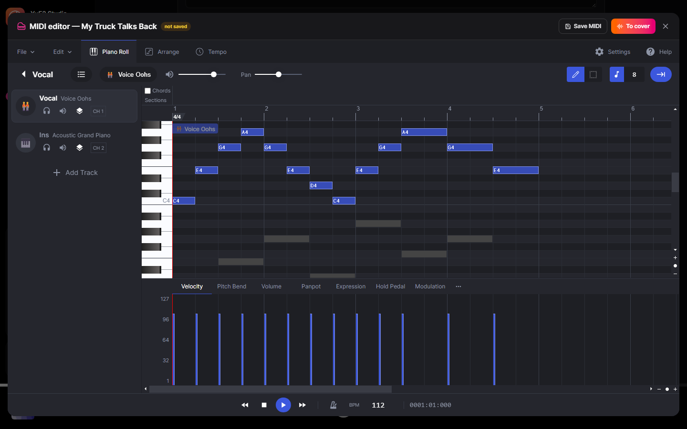
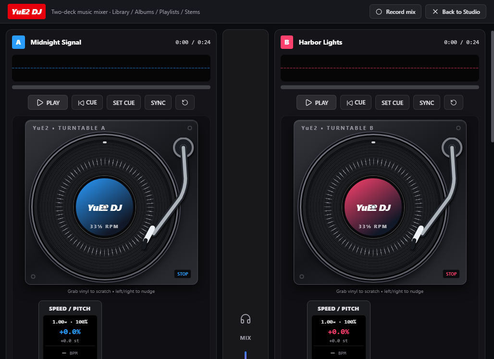
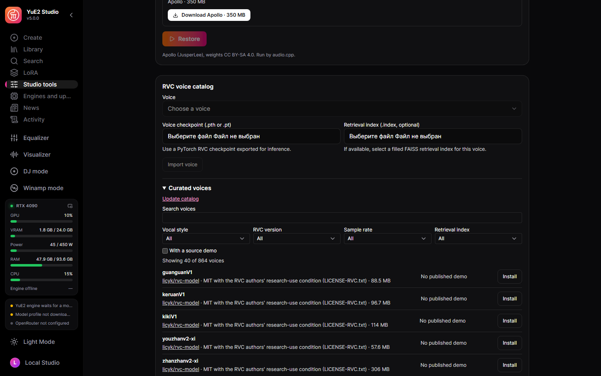
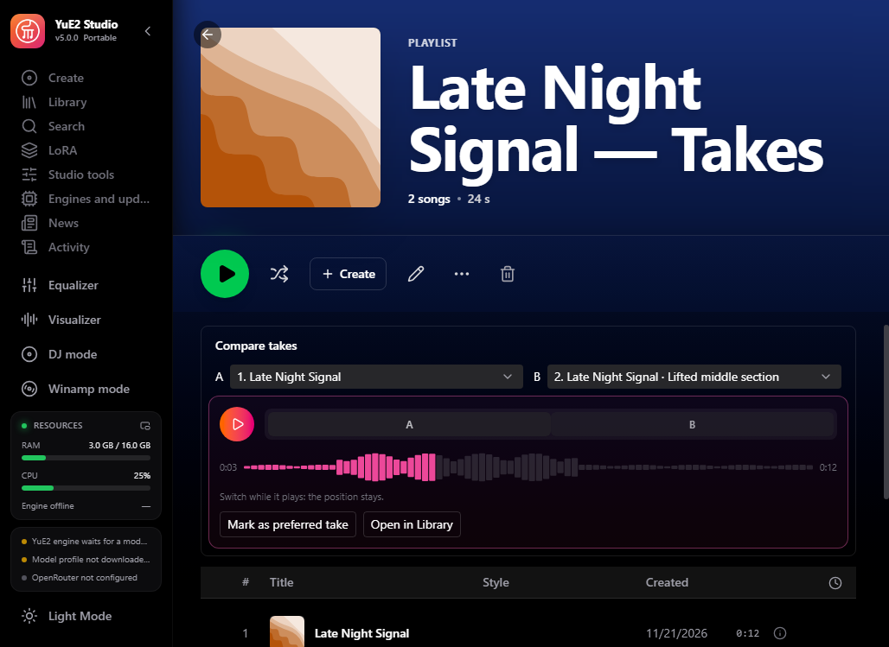
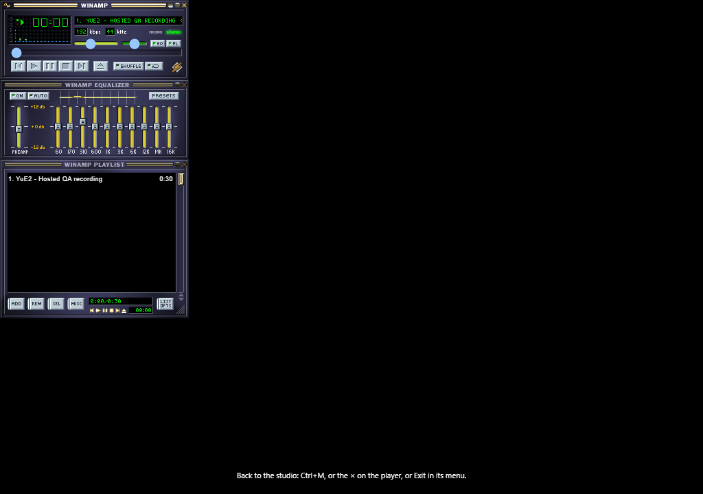
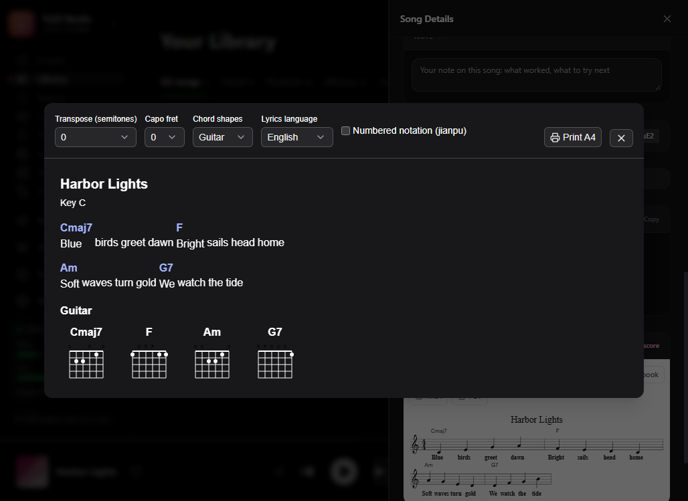
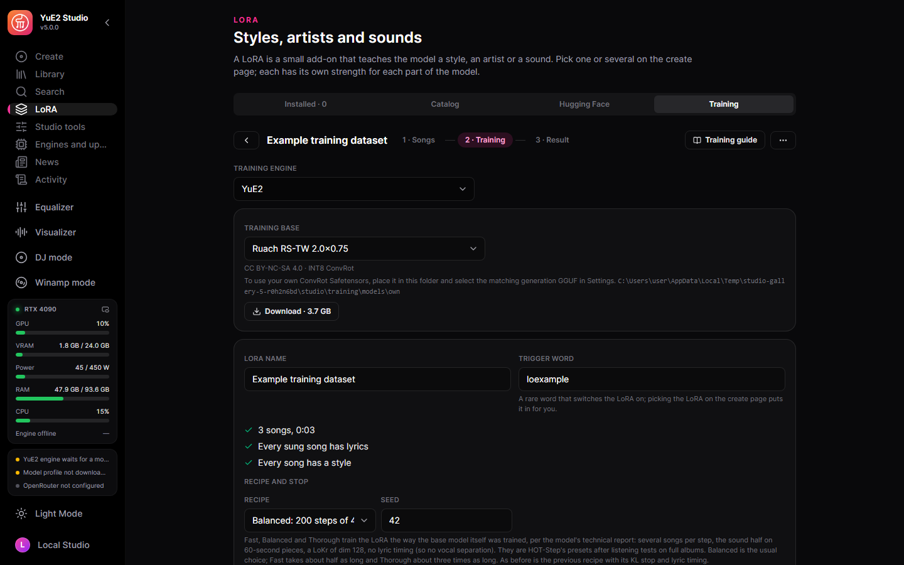
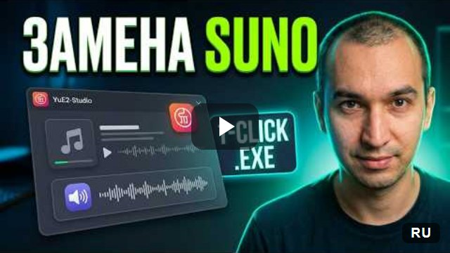
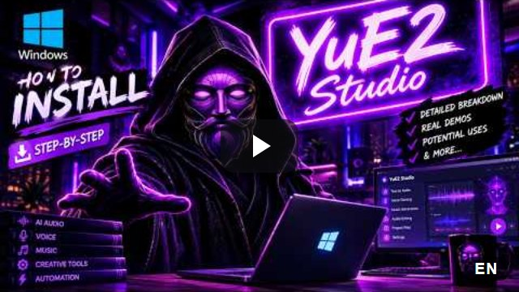
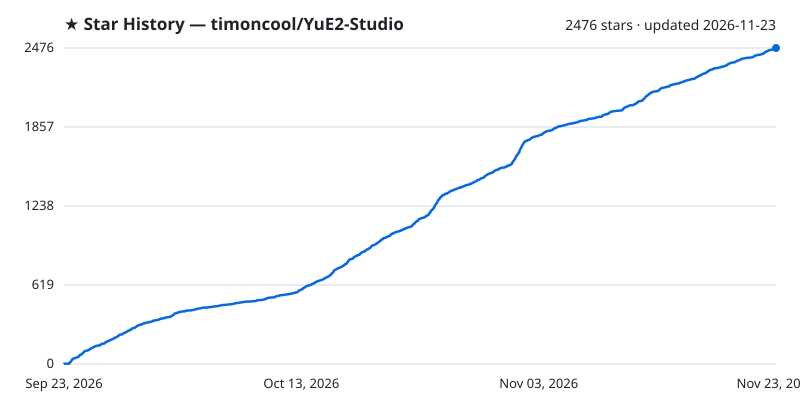

<div align="center">

<!-- studio family tabs -->
[](https://github.com/timoncool/YuE2-Studio) [](https://github.com/timoncool/MiniMax-Music3-Studio) [](https://github.com/timoncool/ACE-Step-Studio)


# YuE2 Studio

**Create songs with YuE2, ACE-Step and MiniMax. Bring your tracks into one library and compare takes made with different engines.**

[](https://timoncool.github.io/YuE2-Studio/)
[](https://github.com/timoncool/YuE2-Studio/releases/latest)
[](DONATE.md)

[](LICENSE)
[](https://github.com/timoncool/YuE2-Studio/stargazers)
[](https://github.com/timoncool/YuE2-Studio/commits/main)
[](https://github.com/timoncool/YuE2-Studio/releases)

**English** · [Русский](https://timoncool.github.io/YuE2-Studio/ru.html) · [中文](https://timoncool.github.io/YuE2-Studio/zh.html) · [日本語](https://timoncool.github.io/YuE2-Studio/ja.html) · [한국어](https://timoncool.github.io/YuE2-Studio/ko.html) · [Português](https://timoncool.github.io/YuE2-Studio/pt.html)


</div>

Choose the model and engine in **Create**. With **YuE2**, describe a style and write the lyrics to get a song with an editable score. Change the melody or chords and render another take. You can also use native **ACE-Step** and **MiniMax Music 3**, choose a supported alternative engine, or generate with a music model from **OpenRouter**.

Songs from the older studios can join the same library with their playlists. Listen to the original recording, compare takes or try a different singing voice with RVC. Local engines run on your computer after their components and weights have been downloaded. On Windows, choose the installer with automatic updates or the portable package. [Import your existing library](guides/en/getting-started.md#bring-your-ace-step-or-minimax-library-into-yue2) · [GPU measurements](#how-fast-is-it)

**Guides:** [Get started](guides/en/getting-started.md) · [Create and edit music](guides/en/creating-music.md) · [Models and runtimes](guides/en/models-and-runtimes.md) · [Benchmarks](guides/en/benchmarks.md) · [MCP and development](guides/en/automation-and-development.md) · [Screenshots and samples](guides/en/showcase.md) · [Community](guides/en/community.md)

## For AI agents

Given this repository, an agent can set everything up and drive the studio by itself:

1. Install the studio from the [latest release](https://github.com/timoncool/YuE2-Studio/releases/latest) and start it,
   with `--headless` to keep its window off the user's screen (see
   [Drive it from an agent](#drive-it-from-an-agent-mcp)).
2. Connect to its MCP server at `http://127.0.0.1:8791/mcp`:
   `claude mcp add --transport http yue2-studio http://127.0.0.1:8791/mcp`
3. Read the skill it serves (resource `studio://skill`, prompt `studio`), the same text as
   [docs/mcp-skill.md](docs/mcp-skill.md), and start with the tool `studio_status`.

[llms.txt](llms.txt) says the same for tools that look for it. To keep the skill in Claude
Code, save [docs/mcp-skill.md](docs/mcp-skill.md) as `~/.claude/skills/yue2-studio/SKILL.md`.

## What you can do

### Make songs

- **YuE2** — a full song up to ten minutes from a style and lyrics, with the score it was sung from.
  Read the score as sheet music, change notes, chords or key and render again: the composition
  stays, the performance changes. Or write the score first, fix it, then sing it.
- **ACE-Step 1.5** — describe the song and its own language model writes the style, the lyrics and
  the metadata. Switch the DiT (Turbo, SFT, Base) and work on a source track: Cover, Remix, Repaint,
  Add track, Extract, Complete.
- **MiniMax Music 3** — the description in three parts (global metadata, vocal details, arrangement)
  with a live count of how much of the model's budget it takes.
- **More models** — HeartMuLa, MuLaCover, Stable Audio 3, MiniMax-H3, MiDashengLM, Magenta RealTime 2,
  Vevo2, SoulX-Singer and the music models on OpenRouter, all in one searchable list.
- **Covers and continuations** — SheetSage2 writes down the melody of a recording and YuE2 sings it
  in your style; hum or write an opening and the model writes the rest; extend a song by up to two
  minutes.
- **Exact replay** — every track keeps its request and audio codes: re-render it bit for bit, or with
  other steps, a new seed or another format, without composing again.
- **A writing assistant** — a local Gemma model, OpenRouter or your connected agent writes the style
  and lyrics from an idea; 110 ready examples load in one click.

### Edit and finish

- **Score, chords and MIDI** — a MIDI editor with tracks, instruments, drums and a MIDI keyboard; a
  chord bed in your tempo, key and meter; a songbook with chords, capo and transposition; any track
  to multi-instrument MIDI.
- **A new voice for a song** — RVC voices from a curated catalogue or your own checkpoint sing over
  the song's accompaniment; train a voice of your own on an NVIDIA card.
- **Stems and sound** — six stems on the GPU and a mixer with mute, solo and pan; restore a track
  after MP3 compression; noise reduction, VST3 plugins and mastering to a reference track.
- **Release-ready files** — WAV, FLAC or MP3 at a loudness target with a report, the song's MIDI, an
  Ableton Live project with its stems, a music video with word-level karaoke.

### Library and player

- **One library for every studio** — bring songs and playlists from ACE-Step Studio and MiniMax
  Music3 Studio, play the original recording, compare two takes at the same position.
- **A player of its own** — a ten-band equalizer, MilkDrop and spectrum visualisers, a Winamp 2 mode
  with eleven skins, and a two-deck DJ mode with cue, sync and a crossfader.
- **Plain files** — playlists, likes, sorting, a cover for every track, title, lyrics and cover
  written into each file's tags; models can move to another disk with one button.

### Train

- **LoRA** — a catalogue of ready ones with their authors credited, a search on Hugging Face, and
  training of your own from a folder of songs: lyrics from lyric databases or by ear, styles written
  by listening, a checkpoint in the library in one click.

### Work with an agent

- **MCP** — 162 tools: an agent such as Claude Code does everything the window does, sees it and
  clicks it, and can run the studio without a window.

Every feature in detail: [Create and edit music](guides/en/creating-music.md).

## Screenshots



| | |
|---|---|
|  |  |
| Two-deck DJ mode: cue, sync, pitch and the crossfader | RVC voices: a curated catalogue or your own checkpoint |
|  |  |
| The score as sheet music and as ABC text | Two takes compared at the same playback position |
|  |  |
| The equalizer and MilkDrop over the studio | The whole window as a skinned Winamp 2 |
|  |  |
| A lyric and chord sheet with capo and transposition | Any track to MIDI, played against the original |
|  |  |
| Your own LoRA trained on the card | An agent over MCP: what to paste into the client |

The same screens in your language are on the [project page](https://timoncool.github.io/YuE2-Studio/);
more in the [Showcase](guides/en/showcase.md).

## Samples

Made in the released build on an RTX 4090 with the recommended BF16 set, nothing edited
afterwards. Listen in the browser on the [project page](https://timoncool.github.io/YuE2-Studio/#samples)
or download the MP3s from [docs/samples](docs/samples).

| Song | How it was made | Style |
|---|---|---|
| [Houseplant Party](docs/samples/houseplant-party.mp3) | English funk disco | funk disco, slap bass, wah guitar, brass, 118 BPM |
| [My Truck Talks Back](docs/samples/my-truck-talks-back.mp3) | Country | country, male baritone, pedal steel, fiddle, 96 BPM |
| [La Siesta](docs/samples/la-siesta.mp3) | Latin pop in Spanish | latin pop, nylon guitar, congas, piano montuno, 102 BPM |
| [外卖小哥](docs/samples/delivery-rider.mp3) | Mandarin city pop | city pop, electric piano, funky bass, 108 BPM |
| [月曜日のサムライ](docs/samples/monday-samurai.mp3) | Japanese rock, anime-opening style | j-rock, female voice, distorted guitars, 168 BPM |
| [Дача, лето, комары](docs/samples/dacha-leto-komary.mp3) | A full song from a style and lyrics | folk pop, warm male voice, accordion, 104 BPM |
| [Дача, лето, комары — джаз](docs/samples/dacha-jazz-cover.mp3) | Cover: SheetSage2 wrote down the melody of the song above, YuE2 sang it as jazz | vintage jazz swing, sultry female crooner, muted trumpet |
| [Понедельник](docs/samples/ponedelnik.mp3) | Blues rock, raspy voice | blues rock, overdriven guitar, hammond organ, 96 BPM |
| [Бабушка на дискотеке](docs/samples/babushka-na-diskoteke.mp3) | Re-rendered from its saved audio codes with 64 solver steps | disco pop, funky bass, string section, 120 BPM |
| [Борщ на орбите](docs/samples/borshch-na-orbite.mp3) | Ska punk | ska punk, brass section, offbeat guitar, 150 BPM |
| [Кот-программист](docs/samples/kot-programmist.mp3) | Synthwave pop, the second take | synthwave pop, analog synths, drum machine, 112 BPM |
| [Ночной вор Барсик](docs/samples/barsik.mp3) | Style and lyrics written by the built-in assistant from a one-line idea | pop-punk, distorted guitars, 185 BPM |

## Community reviews

Video reviews and tutorials from the community (the description links this repo):

<table>
  <tr>
    <td width="33%" align="center" valign="top">
      <a href="https://www.youtube.com/watch?v=6OnV_80f6ko"></a><br/>
      <a href="https://www.youtube.com/watch?v=6OnV_80f6ko"><b>AI Controversy</b></a> · EN<br/>
      <sub>Ditch Suno: This FREE AI Makes Full Songs on Your PC</sub>
    </td>
    <td width="33%" align="center" valign="top">
      <a href="https://www.youtube.com/watch?v=JrNTvpoh318"></a><br/>
      <a href="https://www.youtube.com/watch?v=JrNTvpoh318"><b>ArtSonica</b></a> · ID<br/>
      <sub>Music AI GRATIS OFFLINE / NO INTERNET</sub>
    </td>
    <td width="33%" align="center" valign="top">
      <a href="https://www.youtube.com/watch?v=XxkGZU89FII"></a><br/>
      <a href="https://www.youtube.com/watch?v=XxkGZU89FII"><b>AI VINCI</b></a> · EN<br/>
      <sub>The Suno Killer is Here: it's called YuE2 Studio</sub>
    </td>
  </tr>
  <tr>
    <td width="33%" align="center" valign="top">
      <a href="https://www.youtube.com/watch?v=kpaV_1jyO3E"></a><br/>
      <a href="https://www.youtube.com/watch?v=kpaV_1jyO3E"><b>Mamedov Info</b></a> · RU<br/>
      <sub>YuE2-Studio: лучшая локальная замена Suno</sub>
    </td>
    <td width="33%" align="center" valign="top">
      <a href="https://www.youtube.com/watch?v=JPUU9zB7yio"></a><br/>
      <a href="https://www.youtube.com/watch?v=JPUU9zB7yio"><b>ЮЛАВИ Studio</b></a> · RU<br/>
      <sub>Забудь про Suno? Тестируем YuE2 Studio локально</sub>
    </td>
    <td width="33%" align="center" valign="top">
      <a href="https://www.youtube.com/watch?v=-TjHGgxKwBU"></a><br/>
      <a href="https://www.youtube.com/watch?v=-TjHGgxKwBU"><b>Wizzdome-Music</b></a> · EN<br/>
      <sub>YuE2 Studio On Your Own PC</sub>
    </td>
  </tr>
</table>

Eight more tutorials in English, Russian, Portuguese, Korean, Indonesian, French and Chinese are in the
[Showcase](guides/en/showcase.md#community-reviews). **Made a review or tutorial?** Put a link to the
project in the description and send it through [Issues](https://github.com/timoncool/YuE2-Studio/issues).

## What it needs

- **Windows 10/11 x64.** Linux (.deb, AppImage) and macOS builds are experimental.
- **A graphics card with 6 GB of video memory or more.** NVIDIA from the GTX 900 series on runs on
  CUDA, the fastest path: CUDA 13 for Turing and newer with driver 580 or newer, CUDA 12 for older
  cards and older drivers. AMD and Intel cards run through Vulkan, experimentally. Without a card
  the studio works on the processor, many times slower.
- **4–10 GB of disk** for one YuE2 model set; other models download only when you choose them.
- **LoRA training** (optional): an NVIDIA RTX 30-series card or newer with 11 GB of video memory.

Which card runs which part, Linux and AMD details: [Get started](guides/en/getting-started.md#what-it-needs) ·
[What runs where](guides/en/models-and-runtimes.md#what-runs-where).

## Quick start

1. **Install** — run `YuE2.Studio_x.y.z_x64-setup.exe` from the
   [latest release](https://github.com/timoncool/YuE2-Studio/releases/latest), or unzip the
   portable archive anywhere and run `YuE2-Studio.exe`.
2. **Choose a model set** — the first screen preselects the set your card can run. Press
   download; it fetches only what is missing and resumes if interrupted.
3. **Create** — write a style and lyrics, or load one of the examples, and press Create.
   The engine starts by itself and the song lands in your library with its score.

Everything the studio owns stays in its own folder beside `YuE2-Studio.exe`; deleting the folder
removes the studio. The installed version updates itself. When the installer stops on WebView2,
for a custom data folder, an old ACE-Step or MiniMax library and downloads by hand, see
[Get started](guides/en/getting-started.md#quick-start).

## How fast is it

How long a 3-minute song takes, by graphics card: averages that installations reported over 30 days
(loading the models included; people run different model sets, so yours can differ).

| Your graphics card | A 3-minute song | Speed |
|---|---|---|
| NVIDIA, 24 GB or more | about 1 minute | 2.7× faster than real time |
| NVIDIA, 16 GB | about 2 minutes | 1.6× |
| NVIDIA, 12 GB | about 2 minutes | 1.4× |
| NVIDIA, 8 GB or less | about 5 minutes | 0.6× |
| AMD, 16 GB or more (Vulkan) | 3–4 minutes | 0.9× |
| Intel Arc, 12 GB (Vulkan) | about 7 minutes | 0.4× |
| Apple silicon, 24 GB or more | about 8 minutes | 0.4× |
| Apple silicon, 16 GB | about 15 minutes | 0.2× |
| AMD, 8 GB or less (Vulkan) | about an hour | 0.05× |
| No graphics card (processor) | about 2.5 hours | 0.02× |

On our RTX 4090 with the models loaded:

- **YuE2**, Q8_0 set — 30 seconds of a song in about 5 seconds; a 3:38 song in about 46 seconds.
- **ACE-Step 1.5 Turbo** — 30 seconds of music in under half a second.
- **MiniMax Music 3**, Minimal set — about three times faster than real time.
- **RVC** — a new voice for a 30-second vocal in under 0.3 seconds.

Every run, cold and warm, with memory, CUDA 12 and 13, Vulkan, Linux and Radeon:
[Benchmarks](guides/en/benchmarks.md).

## Models

A YuE2 set is the 3B model that writes the score and the audio codes, the VAE that turns them into
48 kHz stereo, and SheetSage2 for covers. The studio detects your card and preselects a set; the
download is always your decision.

| Your graphics card | Set | Download |
| --- | --- | --- |
| 12 GB and above | Original weights (BF16) | 9.9 GB |
| 8 GB and above | Best (Q8_0) | 5.1 GB |
| 7 GB and above | Balanced (Q6_K) | 4.3 GB |
| 5.5 GB and above | Light (Q5_K_M) | 4.0 GB |

The weights come from [Serveurperso/YuE2-GGUF](https://huggingface.co/Serveurperso/YuE2-GGUF), pinned
and checked by SHA-256. ACE-Step, MiniMax and the other models offer their own sets in the same card
of the create form. Every file with its direct link, where to put it by hand, your own and community
models, and the engine's DLLs: [Models and runtimes](guides/en/models-and-runtimes.md).

## Drive it from an agent (MCP)

While the studio is open it serves MCP at `http://127.0.0.1:8791/mcp`:

```bash
claude mcp add --transport http yue2-studio http://127.0.0.1:8791/mcp
```

An agent that finds the studio closed starts it with `--headless`: no window, a tray icon, and it
stops by itself after ten idle minutes. [docs/mcp-skill.md](docs/mcp-skill.md) is the skill the agent
reads. Building from source and the architecture: [Automation and development](guides/en/automation-and-development.md).

## Anonymous statistics and news

The studio asks the author's server for news at start and then every hour. The request carries no id, so news
arrive whatever you choose below: new items appear on top of the News page or as a strip across the top of the window,
and with no connection the studio shows the news of its release.

The setup screen of the first start has a checkbox **Send anonymous usage statistics**, checked by default. The same
switch is in Settings → Anonymous statistics, next to **What is sent** (the exact report of today) and **New install
id**. While it is checked, the studio sends a day's report a minute after start, every six hours, two minutes after
work ends and when it closes (a later report of the same day replaces the earlier one):

- a random install id made on this computer, not tied to the hardware or an account; unchecking the box deletes it;
- the studio and its version, the OS name and version, the window language;
- the graphics card as vendor, a video memory bucket (up to 8, 12, 16, 24+ GB) and the backend (CUDA, Vulkan or
  processor);
- how many songs were made, failed or were cancelled that day, and the model sets they were made on: a ready-made
  set by name with its parts, one put together by hand by its parts, each with its number of songs;
- why a song failed, as one line with paths, names, links and anything in quotes removed on this computer before it
  leaves; the server keeps these reasons 30 days.

Never: lyrics, prompts, audio, file names or paths, anything personal. The server keeps the country Cloudflare
reports for the connection, not the IP address. `DO_NOT_TRACK=1` or `STUDIO_TELEMETRY=0` in the environment turns
statistics off entirely: no id exists and nothing is counted.

## Other Projects by [@timoncool](https://github.com/timoncool)

| Project | Description |
|---------|-------------|
| [MiniMax Music3 Studio](https://github.com/timoncool/MiniMax-Music3-Studio) | The same studio on MiniMax Music3 — the one this grew out of |
| [ACE-Step Studio](https://github.com/timoncool/ACE-Step-Studio) | AI music studio — songs, vocals, covers, videos |
| [Speech Studio](https://github.com/timoncool/speech-studio) | Offline voice studio — text-to-speech, voice cloning, speech recognition |
| [telegram-api-mcp](https://github.com/timoncool/telegram-api-mcp) | Full Telegram Bot API as an MCP server |

## Authors

- **Nerual Dreming** — [Telegram](https://t.me/nerual_dreming) | [X](https://x.com/nerualdreming) | [neuro-cartel.com](https://neuro-cartel.com) | [ArtGeneration.me](https://artgeneration.me)
- **Нейро-Софт** — [Telegram](https://t.me/neuroport) | portable neural networks

## Acknowledgements

- [M-A-P](https://huggingface.co/m-a-p) for YuE2-3B, the YuE2 VAE and SheetSage2.
- [Mothersuperior](https://huggingface.co/Mothersuperior) for the real-audio tokenizer head the trainer's codes come from and its paired decoder adapter, the decoder companion every render and every training runs on.
- [Serveurperso](https://github.com/ServeurpersoCom) for yue2.cpp, its examples and the GGUF conversions.
- [scragnog](https://github.com/scragnog) for [HOT-Step-CPP](https://github.com/scragnog/HOT-Step-CPP): the LoRA trainer the studio runs (its native joint AR/NAR training for YuE2), the training weights in [scragnog/YuE2-GGUF](https://huggingface.co/scragnog/YuE2-GGUF), the VST3 host, and the noise reduction, Spectral Lifter and mastering designs the studio's audio processing is ported from.
- [sergree](https://github.com/sergree) for [matchering](https://github.com/sergree/matchering), the reference mastering algorithm, and [jeankassio](https://github.com/jeankassio) for the vocal naturalizer in [ComfyUI_MusicTools](https://github.com/jeankassio/ComfyUI_MusicTools).
- The authors of the LoRA in the catalogue, each credited and linked on its card: [Mothersuperior](https://huggingface.co/Mothersuperior), [monsterovich](https://huggingface.co/monsterovich), [atomtanstudio](https://huggingface.co/atomtanstudio), [HaileyStorm](https://huggingface.co/HaileyStorm) and [ntc-ai](https://huggingface.co/ntc-ai).
- The [LAME](https://lame.sourceforge.io) project for the MP3 encoder, [Xiph.Org](https://xiph.org/flac/) for libFLAC, the FLAC encoder, and [Serial-ATA](https://github.com/Serial-ATA/lofty-rs) for lofty, which writes the tags.
- [crmne](https://github.com/crmne) for [Spotifast](https://github.com/crmne/spotifast) (MIT): the equalizer solves its band gains as its `eq.rs` does.
- [Jordan Eldredge](https://github.com/captbaritone) and the Webamp team for [Webamp](https://github.com/captbaritone/webamp) (MIT), which the Winamp mode runs, and for the [Winamp Skin Museum](https://skins.webamp.org). Winamp and its base skin are Nullsoft's.
- [Jordan Berg](https://github.com/jberg) for [Butterchurn](https://github.com/jberg/butterchurn) and [butterchurn-presets](https://github.com/jberg/butterchurn-presets) (MIT), MilkDrop in the browser. MilkDrop itself is Ryan Geiss's, and each preset is its author's, named in its title.
- [Henrique Vianna](https://github.com/hvianna) for [audioMotion-analyzer](https://github.com/hvianna/audioMotion-analyzer) (AGPL-3.0), the spectrum looks of the visualiser.
- [Borewit](https://github.com/Borewit) for [music-metadata](https://github.com/Borewit/music-metadata) (MIT) and [Stuart Knightley](https://github.com/Stuk) for [JSZip](https://github.com/Stuk/jszip) (MIT), which read tracks and skins in the Winamp mode.
- The authors of the skins that come with the studio: Winamp's base skin 2.91 (Nullsoft); Winamp5 Classified (Sven Kistner, Zarko Jovic, GuidoD, Wildrose-Wally); Winamp3 Classified (Steve Gedikian, John Slegers, PeterPan, Wildrose-Wally); Bento Classified and Internet Archive (LuigiHann); Mac OS X 1.5 Aqua (DeeLight); TopazAmp (Kelly McLarnon); Vizor (ViDA); Zaxon Remake (Daniel Jansson); Green Dimension V2 (its author, who signs the readme in ASCII art); XMMS Turquoise (from the XMMS project). Each skin keeps its own readme inside the .wsz.
- [Wikimedia Commons](https://commons.wikimedia.org) and the photographers and filmmakers who give their work to it under CC0 or into the public domain, many of them through [Unsplash](https://unsplash.com): the pictures and clips a track and its video can wear. A chosen picture keeps a link to its page.
- [Florian Körner](https://github.com/FlorianKoerner) for [DiceBear](https://www.dicebear.com) (MIT) and the authors of its CC0 styles, the patterns a track without a cover wears, and the [resvg](https://github.com/linebender/resvg) authors, whose renderer writes them into the track as PNG.
- [MRafStudio](https://github.com/MRafStudio) for the ideas of [pull request #34](https://github.com/timoncool/YuE2-Studio/pull/34): the Activity log, sorting, likes kept in the library and stems under their song.
- [wangsoft](https://github.com/wangsoft) for the Hugging Face mirror setting from wangsoft's fork, and [SkySlider](https://github.com/SkySlider) for the Linux pieces from SkySlider's fork: adapter detection and the parent-death signal.
- [stalexxx](https://github.com/stalexxx) for [pull request #51](https://github.com/timoncool/YuE2-Studio/pull/51): the service on macOS with Metal, a question before quitting during a song, and a stop that is kept at once.
- [pytraveler](https://github.com/pytraveler) for [YuE2-ComfyUI](https://github.com/pytraveler/YuE2-ComfyUI) (Apache-2.0): the reader and writer of YuE2's score, the score as a MIDI file and a MIDI file read back into a score are ported from it.
- [ryohey](https://github.com/ryohey) for [signal](https://github.com/ryohey/signal) (MIT), the MIDI editor, and Milton Paredes for the A320U SoundFonts it plays (GPL-2.0).

## Report a problem

Open **Report a problem** in **Settings → About**. **Send via GitHub** opens the issue
form with your draft filled in. You can preview the report before choosing
**Send anonymously**, which lets Studio Hub file a public issue without a GitHub account.

## Support the Author

I build open-source software and do AI research. Most of what I create is free and available to everyone. Your donations help me keep creating without worrying about where the next meal comes from =)

**[All donation methods](DONATE.md)** · [Русский](DONATE.ru.md) · [中文](DONATE.zh.md) · [日本語](DONATE.ja.md) · [한국어](DONATE.ko.md) · [Português](DONATE.pt.md) | **[dalink.to/nerual_dreming](https://dalink.to/nerual_dreming)** | **[boosty.to/neuro_art](https://boosty.to/neuro_art)**

- **BTC:** `1E7dHL22RpyhJGVpcvKdbyZgksSYkYeEBC`
- **ETH (ERC20):** `0xb5db65adf478983186d4897ba92fe2c25c594a0c`
- **USDT (TRC20):** `TQST9Lp2TjK6FiVkn4fwfGUee7NmkxEE7C`

## Star History

<a href="https://github.com/timoncool/YuE2-Studio/stargazers">
 <picture>
   <source media="(prefers-color-scheme: dark)" srcset="docs/stars-dark.svg" />
   <source media="(prefers-color-scheme: light)" srcset="docs/stars-light.svg" />
   
 </picture>
</a>

## License

The studio is MIT, and so is yue2.cpp. **The models are not.** The YuE2-3B and YuE2 VAE
weights are **CC BY-NC 4.0 with an individual-creator permission**
([MODEL_LICENSE](https://github.com/multimodal-art-projection/YuE/blob/main/MODEL_LICENSE),
16 September 2026): personal users, content creators and musicians acting on their own may use
them free of charge and publish, sell, license or otherwise monetize the songs they make, as long
as the use is not illegal, harmful or deceptive. Companies that want to use the weights
commercially need a license from their authors. SheetSage2, which reads the source song for
covers, and the decoder companion (Mothersuperior) are **CC BY-NC 4.0** without that permission.

One bundled component is under a different licence: the visualiser's spectrum looks come from
[audioMotion-analyzer](https://github.com/hvianna/audioMotion-analyzer), which is **AGPL-3.0**;
its source, like the studio's, is public.

The score reader and writer and the MIDI import are ported from
[YuE2-ComfyUI](https://github.com/pytraveler/YuE2-ComfyUI), which is **Apache-2.0**; its licence is
kept in [licenses/YuE2-ComfyUI-Apache-2.0.txt](licenses/YuE2-ComfyUI-Apache-2.0.txt). The MIDI
editor is [signal](https://github.com/ryohey/signal), **MIT**, built from
[our fork](https://github.com/timoncool/signal/tree/studio); the A320U SoundFonts it plays are
**GPL-2.0**, their licence in [licenses/A320U-soundfont-GPL-2.0.txt](licenses/A320U-soundfont-GPL-2.0.txt).

What changed and when is in [CHANGELOG.md](CHANGELOG.md).
