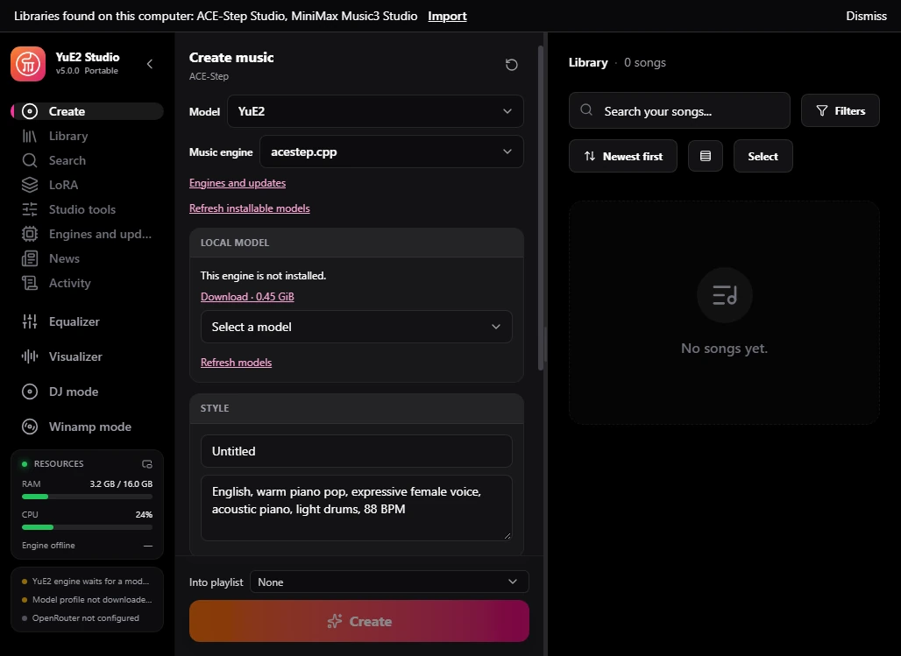

# YuE2 Studio

[English](README.md) · [Русский](README.ru.md) · [中文](README.zh.md) · [日本語](README.ja.md) · [한국어](README.ko.md) · **Português**

Crie música com YuE2, ACE-Step e MiniMax num único estúdio. Importe faixas e listas de reprodução, compare versões e experimente outras vozes com RVC.

[Descarregar o YuE2 Studio](https://github.com/timoncool/YuE2-Studio/releases/latest) · [Site do projeto](https://timoncool.github.io/YuE2-Studio/pt.html) · [Apoiar o projeto](DONATE.pt.md)

## Crie a sua primeira canção

Para Windows x64, estão disponíveis o instalador e o ZIP portátil; para Linux x86-64, o DEB e o AppImage; para Mac com Apple Silicon, o DMG. Na primeira execução, instale os componentes e os pesos necessários para o modelo escolhido.

Abra **Criar**, escolha o YuE2 e um perfil instalado, introduza o estilo e a letra ou carregue um exemplo. Carregue em **Criar** e ouça a faixa pronta na **Biblioteca**.

## Migre a biblioteca

Abra **Biblioteca → Importar → Biblioteca do ACE-Step ou MiniMax**. Selecione uma biblioteca encontrada do ACE-Step Studio ou MiniMax Music3 Studio, ou carregue em **Escolher pasta do Studio antigo**. Confirme o conteúdo e o espaço necessário e carregue em **Copiar biblioteca para o YuE2**. A biblioteca original permanece no mesmo local.

[Como começar](https://timoncool.github.io/YuE2-Studio/pt.html#start) · [O que faz](https://timoncool.github.io/YuE2-Studio/pt.html#features) · [Medições de desempenho](https://timoncool.github.io/YuE2-Studio/pt.html#speed) · [Capturas de ecrã](https://timoncool.github.io/YuE2-Studio/pt.html#screenshots) · [Músicas feitas com ele](https://timoncool.github.io/YuE2-Studio/pt.html#listen)

[Instalação e migração (em inglês)](guides/en/getting-started.md) · [Criação musical (em inglês)](guides/en/creating-music.md) · [Modelos e ambientes de execução (em inglês)](guides/en/models-and-runtimes.md) · [Medições de desempenho (em inglês)](guides/en/benchmarks.md) · [MCP e desenvolvimento (em inglês)](guides/en/automation-and-development.md) · [Capturas e amostras (em inglês)](guides/en/showcase.md) · [Comunidade (em inglês)](guides/en/community.md)

