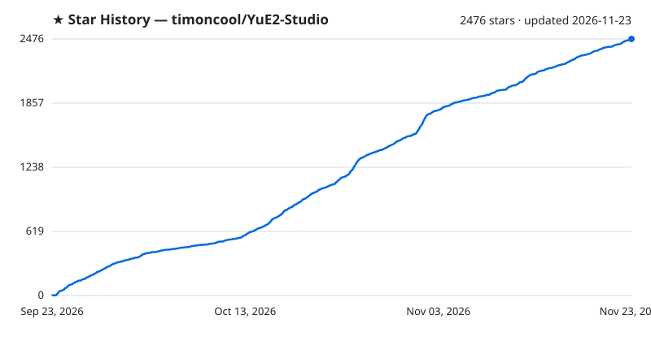

# Community and project information

[Back to YuE2 Studio](../../README.md)

## Anonymous statistics and news

The studio asks the author's server for news at start and then every hour. The request carries no id, so news
arrive whatever you choose below: new items appear on top of the News page or as a strip across the top of the window,
and with no connection the studio shows the news of its release.

The setup screen of the first start has a checkbox **Send anonymous usage statistics**, checked by default. The same
switch is in Settings → Anonymous statistics, next to **What is sent** (the exact report of today) and **New install
id**. While it is checked, the studio sends a day's report a minute after start, every six hours, two minutes after
work ends and when it closes (a later report of the same day replaces the earlier one):

- a random install id made on this computer, not tied to the hardware or an account; unchecking the box deletes it;
- the studio and its version, the OS name and version, the window language;
- the graphics card as vendor, a video memory bucket (up to 8, 12, 16, 24+ GB) and the backend (CUDA, Vulkan or
  processor);
- how many songs were made, failed or were cancelled that day, and the model sets they were made on: a ready-made
  set by name with its parts, one put together by hand by its parts, each with its number of songs;
- why a song failed, as one line with paths, names, links and anything in quotes removed on this computer before it
  leaves; the server keeps these reasons 30 days.

Never: lyrics, prompts, audio, file names or paths, anything personal. The server keeps the country Cloudflare
reports for the connection, not the IP address. `DO_NOT_TRACK=1` or `STUDIO_TELEMETRY=0` in the environment turns
statistics off entirely: no id exists and nothing is counted.

## Other Projects by [@timoncool](https://github.com/timoncool)

| Project | Description |
|---------|-------------|
| [MiniMax Music3 Studio](https://github.com/timoncool/MiniMax-Music3-Studio) | The same studio on MiniMax Music3 — the one this grew out of |
| [ACE-Step Studio](https://github.com/timoncool/ACE-Step-Studio) | AI music studio — songs, vocals, covers, videos |
| [Speech Studio](https://github.com/timoncool/speech-studio) | Offline voice studio — text-to-speech, voice cloning, speech recognition |
| [telegram-api-mcp](https://github.com/timoncool/telegram-api-mcp) | Full Telegram Bot API as an MCP server |

## Authors

- **Nerual Dreming** — [Telegram](https://t.me/nerual_dreming) | [X](https://x.com/nerualdreming) | [neuro-cartel.com](https://neuro-cartel.com) | [ArtGeneration.me](https://artgeneration.me)
- **Нейро-Софт** — [Telegram](https://t.me/neuroport) | portable neural networks

## Acknowledgements

- [M-A-P](https://huggingface.co/m-a-p) for YuE2-3B, the YuE2 VAE and SheetSage2.
- [Mothersuperior](https://huggingface.co/Mothersuperior) for the real-audio tokenizer head the trainer's codes come from and its paired decoder adapter, the decoder companion every render and every training runs on.
- [Serveurperso](https://github.com/ServeurpersoCom) for yue2.cpp, its examples and the GGUF conversions.
- [scragnog](https://github.com/scragnog) for [HOT-Step-CPP](https://github.com/scragnog/HOT-Step-CPP): the LoRA trainer the studio runs (its native joint AR/NAR training for YuE2), the training weights in [scragnog/YuE2-GGUF](https://huggingface.co/scragnog/YuE2-GGUF), the VST3 host, and the noise reduction, Spectral Lifter and mastering designs the studio's audio processing is ported from.
- [sergree](https://github.com/sergree) for [matchering](https://github.com/sergree/matchering), the reference mastering algorithm, and [jeankassio](https://github.com/jeankassio) for the vocal naturalizer in [ComfyUI_MusicTools](https://github.com/jeankassio/ComfyUI_MusicTools).
- The authors of the LoRA in the catalogue, each credited and linked on its card: [Mothersuperior](https://huggingface.co/Mothersuperior), [monsterovich](https://huggingface.co/monsterovich), [atomtanstudio](https://huggingface.co/atomtanstudio), [HaileyStorm](https://huggingface.co/HaileyStorm) and [ntc-ai](https://huggingface.co/ntc-ai).
- The [LAME](https://lame.sourceforge.io) project for the MP3 encoder, [Xiph.Org](https://xiph.org/flac/) for libFLAC, the FLAC encoder, and [Serial-ATA](https://github.com/Serial-ATA/lofty-rs) for lofty, which writes the tags.
- [crmne](https://github.com/crmne) for [Spotifast](https://github.com/crmne/spotifast) (MIT): the equalizer solves its band gains as its `eq.rs` does.
- [Jordan Eldredge](https://github.com/captbaritone) and the Webamp team for [Webamp](https://github.com/captbaritone/webamp) (MIT), which the Winamp mode runs, and for the [Winamp Skin Museum](https://skins.webamp.org). Winamp and its base skin are Nullsoft's.
- [Jordan Berg](https://github.com/jberg) for [Butterchurn](https://github.com/jberg/butterchurn) and [butterchurn-presets](https://github.com/jberg/butterchurn-presets) (MIT), MilkDrop in the browser. MilkDrop itself is Ryan Geiss's, and each preset is its author's, named in its title.
- [Henrique Vianna](https://github.com/hvianna) for [audioMotion-analyzer](https://github.com/hvianna/audioMotion-analyzer) (AGPL-3.0), the spectrum looks of the visualiser.
- [Borewit](https://github.com/Borewit) for [music-metadata](https://github.com/Borewit/music-metadata) (MIT) and [Stuart Knightley](https://github.com/Stuk) for [JSZip](https://github.com/Stuk/jszip) (MIT), which read tracks and skins in the Winamp mode.
- The authors of the skins that come with the studio: Winamp's base skin 2.91 (Nullsoft); Winamp5 Classified (Sven Kistner, Zarko Jovic, GuidoD, Wildrose-Wally); Winamp3 Classified (Steve Gedikian, John Slegers, PeterPan, Wildrose-Wally); Bento Classified and Internet Archive (LuigiHann); Mac OS X 1.5 Aqua (DeeLight); TopazAmp (Kelly McLarnon); Vizor (ViDA); Zaxon Remake (Daniel Jansson); Green Dimension V2 (its author, who signs the readme in ASCII art); XMMS Turquoise (from the XMMS project). Each skin keeps its own readme inside the .wsz.
- [Wikimedia Commons](https://commons.wikimedia.org) and the photographers and filmmakers who give their work to it under CC0 or into the public domain, many of them through [Unsplash](https://unsplash.com): the pictures and clips a track and its video can wear. A chosen picture keeps a link to its page.
- [Florian Körner](https://github.com/FlorianKoerner) for [DiceBear](https://www.dicebear.com) (MIT) and the authors of its CC0 styles, the patterns a track without a cover wears, and the [resvg](https://github.com/linebender/resvg) authors, whose renderer writes them into the track as PNG.
- [MRafStudio](https://github.com/MRafStudio) for the ideas of [pull request #34](https://github.com/timoncool/YuE2-Studio/pull/34): the Activity log, sorting, likes kept in the library and stems under their song.
- [wangsoft](https://github.com/wangsoft) for the Hugging Face mirror setting from wangsoft's fork, and [SkySlider](https://github.com/SkySlider) for the Linux pieces from SkySlider's fork: adapter detection and the parent-death signal.
- [stalexxx](https://github.com/stalexxx) for [pull request #51](https://github.com/timoncool/YuE2-Studio/pull/51): the service on macOS with Metal, a question before quitting during a song, and a stop that is kept at once.
- [pytraveler](https://github.com/pytraveler) for [YuE2-ComfyUI](https://github.com/pytraveler/YuE2-ComfyUI) (Apache-2.0): the reader and writer of YuE2's score, the score as a MIDI file and a MIDI file read back into a score are ported from it.
- [ryohey](https://github.com/ryohey) for [signal](https://github.com/ryohey/signal) (MIT), the MIDI editor, and Milton Paredes for the A320U SoundFonts it plays (GPL-2.0).

## Report a problem

Open **Report a problem** in **Settings → About**. **Send via GitHub** opens the issue
form with your draft filled in. You can preview the report before choosing
**Send anonymously**, which lets Studio Hub file a public issue without a GitHub account.

## Support the Author

I build open-source software and do AI research. Most of what I create is free and available to everyone. Your donations help me keep creating without worrying about where the next meal comes from =)

**[All donation methods](../../DONATE.md)** · [Русский](../../DONATE.ru.md) · [中文](../../DONATE.zh.md) · [日本語](../../DONATE.ja.md) · [한국어](../../DONATE.ko.md) · [Português](../../DONATE.pt.md) | **[dalink.to/nerual_dreming](https://dalink.to/nerual_dreming)** | **[boosty.to/neuro_art](https://boosty.to/neuro_art)**

- **BTC:** `1E7dHL22RpyhJGVpcvKdbyZgksSYkYeEBC`
- **ETH (ERC20):** `0xb5db65adf478983186d4897ba92fe2c25c594a0c`
- **USDT (TRC20):** `TQST9Lp2TjK6FiVkn4fwfGUee7NmkxEE7C`

## Star History

<a href="https://github.com/timoncool/YuE2-Studio/stargazers">
 <picture>
   <source media="(prefers-color-scheme: dark)" srcset="../../docs/stars-dark.svg" />
   <source media="(prefers-color-scheme: light)" srcset="../../docs/stars-light.svg" />
   
 </picture>
</a>

## License

The studio is MIT, and so is yue2.cpp. **The models are not.** The YuE2-3B and YuE2 VAE
weights are **CC BY-NC 4.0 with an individual-creator permission**
([MODEL_LICENSE](https://github.com/multimodal-art-projection/YuE/blob/main/MODEL_LICENSE),
16 September 2026): personal users, content creators and musicians acting on their own may use
them free of charge and publish, sell, license or otherwise monetize the songs they make, as long
as the use is not illegal, harmful or deceptive. Companies that want to use the weights
commercially need a license from their authors. SheetSage2, which reads the source song for
covers, and the decoder companion (Mothersuperior) are **CC BY-NC 4.0** without that permission.

One bundled component is under a different licence: the visualiser's spectrum looks come from
[audioMotion-analyzer](https://github.com/hvianna/audioMotion-analyzer), which is **AGPL-3.0**;
its source, like the studio's, is public.

The score reader and writer and the MIDI import are ported from
[YuE2-ComfyUI](https://github.com/pytraveler/YuE2-ComfyUI), which is **Apache-2.0**; its licence is
kept in [licenses/YuE2-ComfyUI-Apache-2.0.txt](../../licenses/YuE2-ComfyUI-Apache-2.0.txt). The MIDI
editor is [signal](https://github.com/ryohey/signal), **MIT**, built from
[our fork](https://github.com/timoncool/signal/tree/studio); the A320U SoundFonts it plays are
**GPL-2.0**, their licence in [licenses/A320U-soundfont-GPL-2.0.txt](../../licenses/A320U-soundfont-GPL-2.0.txt).

What changed and when is in [CHANGELOG.md](../../CHANGELOG.md).

Next: [get started](getting-started.md) · [create and edit music](creating-music.md) ·
[browse sample tracks](showcase.md).
