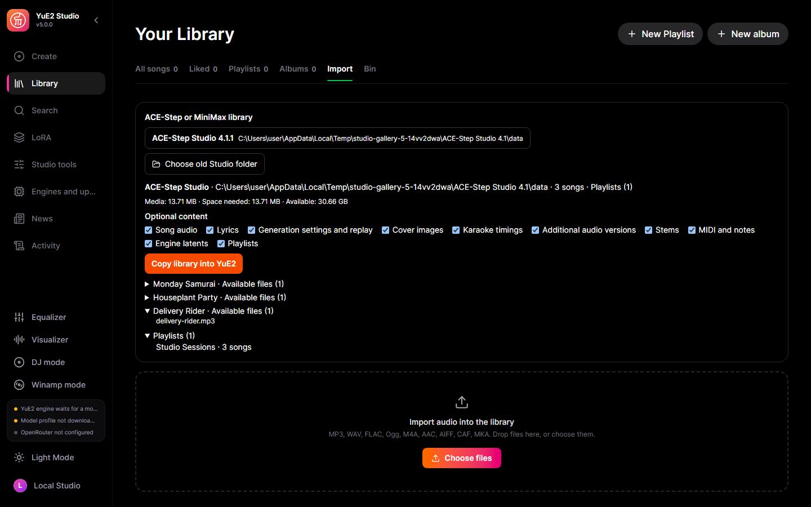

# Get started with YuE2 Studio

[Back to YuE2 Studio](../../README.md)

## What it needs

- Windows 10/11 x64.
- A GPU with **6 GB of VRAM** or more:
  - **NVIDIA**, from the GTX 900 series on, runs on CUDA — the fastest path. The studio
    ships two CUDA builds of the engine and picks the one your card and driver run:
    CUDA 13 for Turing and newer (GTX 16, RTX 20–50, Tesla T4, A100, RTX A-series,
    L4/L40, H100) with driver 580 or newer, CUDA 12 for Maxwell, Pascal and Volta
    (GTX 900/1000, Titan X/Xp/V, Tesla M40, P40, P100, V100). CUDA 12 also serves
    supported newer cards with a compatible driver below 580. Both packages include
    native images for 7.5, 8.0, 8.6, 8.9, 9.0 and `sm_120a` for GeForce RTX 50.
    CUDA 12 adds 5.2, 6.0, 6.1 and 7.0. The [speed and memory figures](benchmarks.md)
    are from the RTX 4090. [NVIDIA compute capabilities](https://developer.nvidia.com/cuda/gpus)
  - **AMD or Intel — experimental on Vulkan.** The engine can use the card's own Vulkan
    driver. On Windows x64, compatible AMD cards can also install the optional HIP (ROCm)
    component from **Settings → Local engine**; choose **Install HIP component**, then
    **HIP (ROCm)**. Vulkan remains available. Owners report songs made well on a Radeon
    RX 7900 XT under Windows and an RX 7900 XTX under Ubuntu 26
    ([#196](https://github.com/timoncool/YuE2-Studio/issues/196)), but on AMD Radeon
    integrated graphics the song came out with unintelligible vocals, and Intel cards are
    untested. LoRA training stays on NVIDIA. Reports from owners are welcome.
  - Without a GPU the engine falls back to the processor, which works but is many times
    slower.
- 4–10 GB of disk for one model set.
- Training a LoRA (optional): an NVIDIA RTX 30-series card or newer with 11 GB of VRAM
  and about 8 GB more disk for the trainer and its weights, downloaded only when you open
  training. Describing songs by ear needs about 12 GB of VRAM and 10 GB more disk for
  MOSS-Music; without it the styles are written by hand.

### Linux (experimental)

The .deb and the AppImage for Linux x86-64 are **experimental**. They come from the same code with the
Linux build of the same engine (CUDA 13 and CUDA 12 on NVIDIA cards, Vulkan on the others, and the
processor), but the author works on Windows and has not run them on a real Linux desktop. **If you live on
Linux, it would be great if you polished them and sent the fixes back as a pull request.** The studio keeps
its data in `~/.local/share/yue2-studio` (`$XDG_DATA_HOME`).

## Quick start

1. **Install** — download the build for your platform from the
   [latest release](https://github.com/timoncool/YuE2-Studio/releases/latest): on Windows,
   run `YuE2.Studio_x.y.z_x64-setup.exe` or unpack the portable ZIP and run
   `YuE2-Studio.exe`; on Linux x86-64, install the `.deb` or make the AppImage executable
   and launch it; on Apple Silicon, open the `.dmg`, move YuE2 Studio to Applications and
   launch it. Linux packages are experimental; there is no Intel Mac build.
2. **Choose a model set** — on first launch, pick the recommended set and press **Download**.
   Studio downloads only missing files and resumes an interrupted download.
3. **Create** — open **Create**. In **Simple**, describe the song in **DESCRIBE YOUR SONG**;
   or choose **Custom** and enter a style and lyrics. Press **Create**. The song appears in
   **Library** with its score.

Everything the studio owns stays in its own folder: models, songs, settings, logs,
temporary files and the WebView2 profile, beside `YuE2-Studio.exe`. That holds for the
portable archive and for an installation into any folder the studio can write to;
deleting the folder removes the studio. Only an installation into a read-only location
such as Program Files falls back to `%LOCALAPPDATA%\YuE2 Studio`. The installed version
updates itself: a new release is offered inside the studio and installed in place.

## Make your first song

After the model set is ready, open **Create** and stay in **Simple** mode. In **DESCRIBE
YOUR SONG**, write a short idea such as “a warm acoustic folk song about coming home” and
press **Create**. For more control, choose **Custom**, fill in **STYLE OF MUSIC** and
**LYRICS**, then press **Create**. To start from a working example, click the dice icon
beside **Style** and choose a sample; it fills in the request for you.
The finished song appears in **Library** while its editable score is available from the
song view.

Next: [create and edit music](creating-music.md) · [choose models and engines](models-and-runtimes.md) ·
[browse sample tracks](showcase.md) · [report a problem](community.md#report-a-problem).

**If the installer stops on WebView2.** The studio's window runs on Microsoft Edge WebView2,
and the installer fetches it when Windows lacks it. On a blocked or unsteady connection, or on
Windows 10 builds that refuse Microsoft's small bootstrapper (error 0x80040902), that fetch
fails and the installer says so. Install WebView2 from Microsoft's standalone installer,
[Evergreen Standalone x64](https://go.microsoft.com/fwlink/p/?LinkId=2124701), then run the
studio's installer again.

### Upgrade a custom Studio data folder

If your launcher sets `YUE_STUDIO_DATA_ROOT`, YuE2 Studio 5.0 uses that folder for the library and for the default settings and model paths. Earlier desktop versions could store the settings and models in the installation's ordinary data folder while the library went to your custom folder.

Look for your previous `studio-settings.json` and `models/yue2-cpp` directory under `data` beside the executable. If the installation used the per-user location, check `$XDG_DATA_HOME/yue2-studio` (usually `~/.local/share/yue2-studio`) on Linux, `%LOCALAPPDATA%\YuE2 Studio` on Windows, or `~/Library/Application Support/YuE2 Studio` on macOS.

If you recognize those files as belonging to this profile, you can use them in place. Start with the previous settings path and model directory explicitly selected. Keep the path to your library as `YUE_STUDIO_DATA_ROOT`.

```bash
export YUE_STUDIO_DATA_ROOT="$HOME/my-yue-library"
legacy="$HOME/.local/share/yue2-studio"
export YUE_STUDIO_SETTINGS_PATH="$legacy/studio-settings.json"
export YUE_MODELS_ROOT="$legacy/models/yue2-cpp"
/usr/bin/YuE2-Studio
```

For AppImage use the AppImage path in the last line. In PowerShell use `$env:YUE_STUDIO_SETTINGS_PATH` and `$env:YUE_MODELS_ROOT` with the paths you located. Use a separate settings file when two profiles previously shared that directory and you want independent preferences. After backing up your settings, you can copy that small JSON into your custom data folder and remove only the settings override. Keep the model override if you want the studio to use the existing weights in place.

### Bring your ACE-Step or MiniMax library into YuE2

In YuE2 Studio 5.0, open **Library → Import → ACE-Step or MiniMax library**. Select the old studio from the list, or use **Choose old Studio folder** to locate it yourself.



*Review the source, available songs and playlists, optional content and destination space before copying.*

The preview shows the source folder, songs, playlists and space needed on the destination drive. Expand a song to see which files are available and which are missing. Once you have the right library, select **Copy library into YuE2**. The original library stays in place. You can run the import again; the summary distinguishes new songs and playlists from items already imported.

Open an imported song in **Library** to play the original recording. To make a new song with the familiar engine, open **Create** and select the native ACE-Step or MiniMax engine and model.

### Install Windows runtime archives manually

If a runtime download fails, open the studio data folder from Settings. Download the
exact archive from the URL in the error and leave its original filename and contents intact.

| Feature | Where to put the archive, relative to the data folder |
| --- | --- |
| Karaoke timeline / transcribe.cpp | `karaoke/runtime/`, for example `transcribe-windows-cuda13-x64.zip` |
| Style by ear / MOSS-Music | `training/ace-caption-windows-x64.zip` |
| LoRA training | `training/hotstep-tools-cuda-windows-x64.zip` |
| audio.cpp | `audiocpp/runtime/`, for example `audiocpp-server-win-cuda13-x64.zip` |

Press **Download** again for the same feature. The studio checks the archive against
the SHA-256 pinned for this release, extracts it and records the installation. It
downloads other missing dependencies separately. When setting up both training and
style by ear, install the full training runtime first. It includes the matching captioner.

Next: [back to YuE2 Studio](../../README.md) · [create and edit music](creating-music.md) ·
[choose models and engines](models-and-runtimes.md) · [get help](community.md#report-a-problem).
